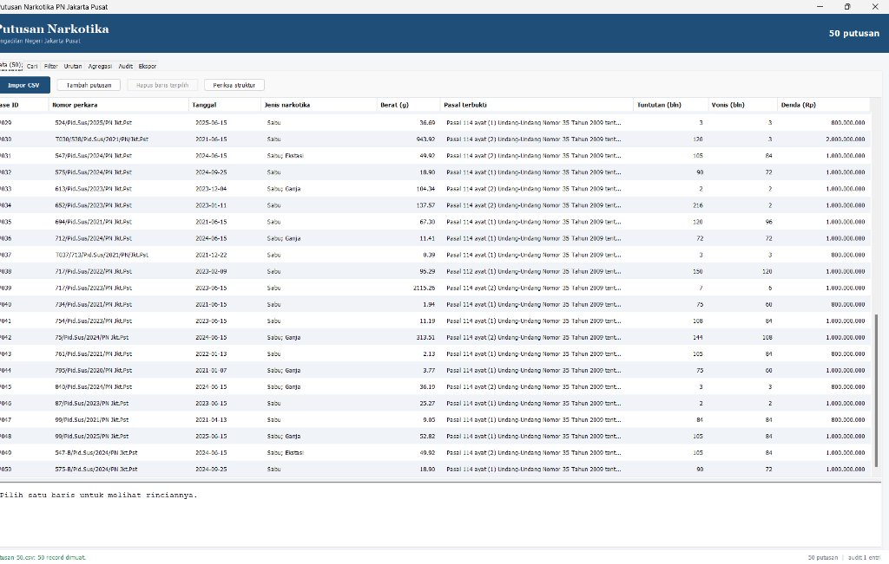
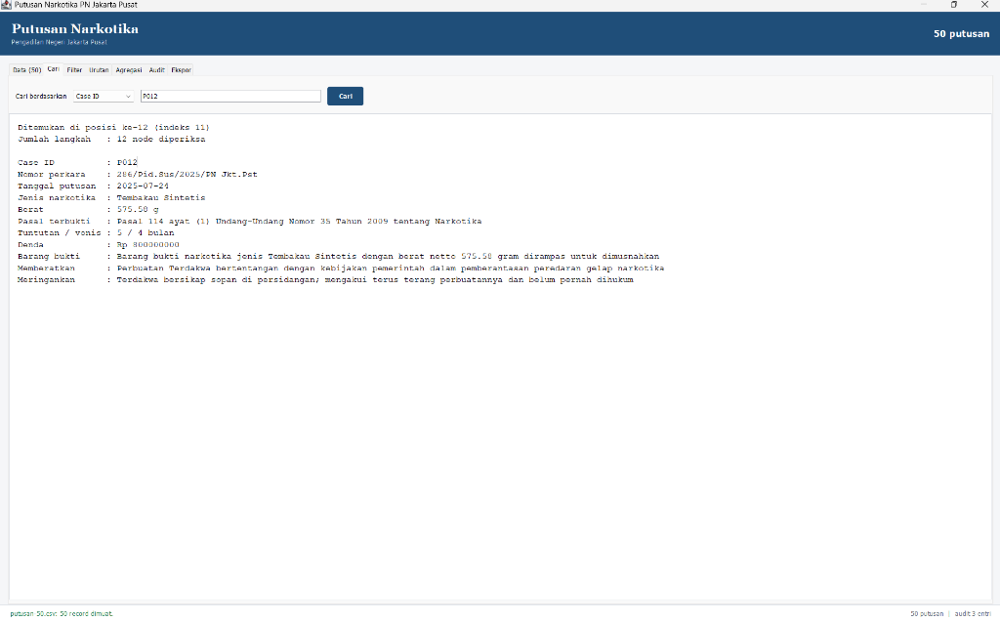
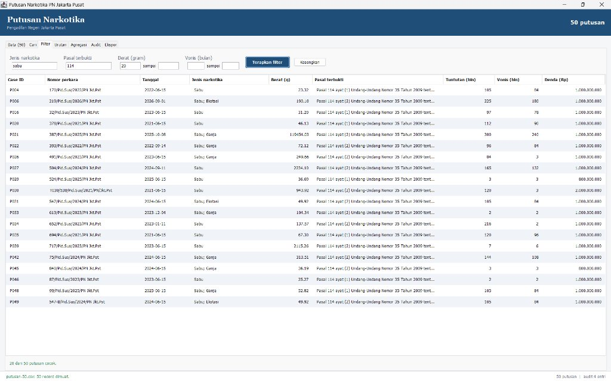
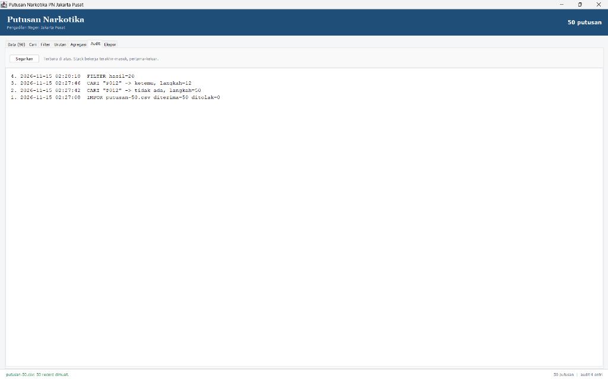
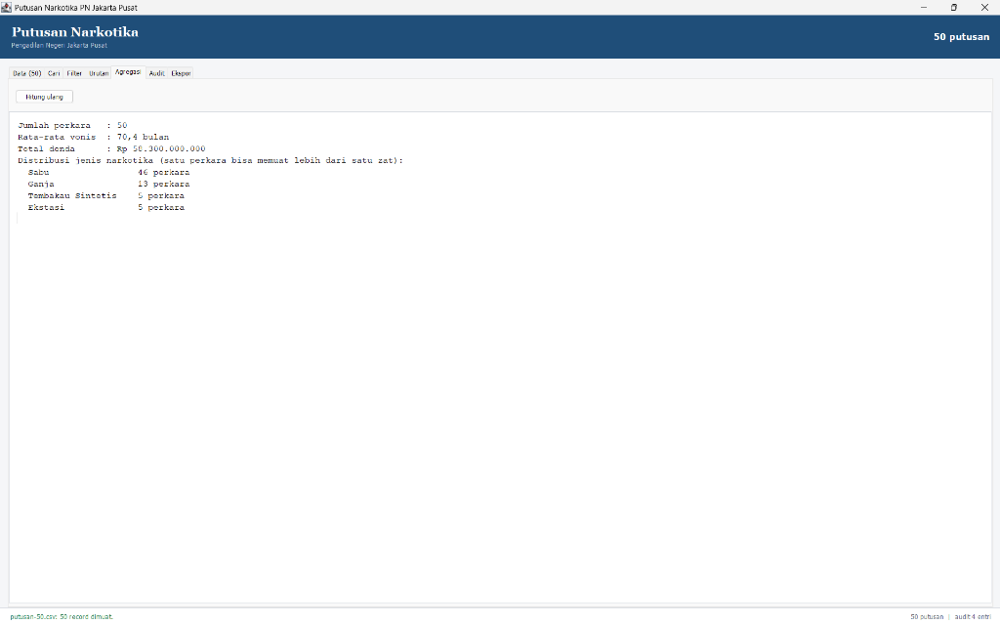
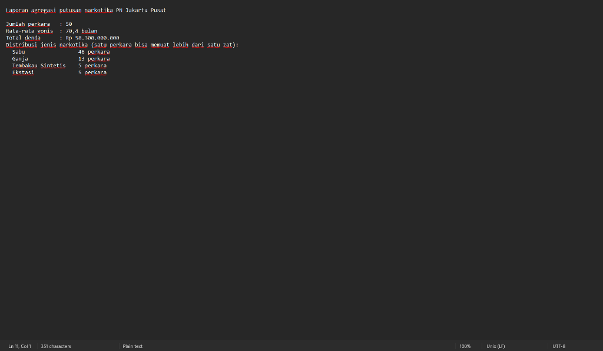

# Dokumentasi Demo Aplikasi Putusan Narkotika

Berikut adalah bukti jalannya aplikasi **Sistem Data Putusan Narkotika (PN Jakarta Pusat)** untuk seluruh fitur utama yang diwajibkan.

---

## 1. Impor 50 Data Putusan (`putusan-50.csv`)

Saat file `putusan-50.csv` diimpor, aplikasi berhasil memuat tepat **50 record putusan** (`P001`–`P050`) ke dalam struktur data utama **Singly Linked List** tanpa ada data yang ditolak.

---

## 2. Pencarian Putusan (`Linear Search`)

Pada demo pencarian berdasarkan `Case ID` dengan kata kunci **`P012`**, data langsung ditemukan di **posisi ke-12 (indeks 11)** dengan jumlah penelusuran sebanyak **12 node diperiksa**, lengkap dengan rincian perkaranya.

---

## 3. Filter Data Putusan

Pada tab **Filter**, dicoba filter gabungan dengan kriteria jenis narkotika **`sabu`**, pasal terbukti **`114`**, dan berat minimal **`20` gram**. Dari 50 data, aplikasi menampilkan **20 putusan yang cocok**.

---

## 4. Riwayat Audit (`Stack`)

Tab **Audit** mencatat seluruh aktivitas pengguna ke dalam struktur sekunder **Stack** (urutan terbaru di paling atas), mulai dari proses impor 50 data, pencarian yang tidak ketemu (50 langkah) maupun ketemu (12 langkah), hingga hasil filter.

---

## 5. Agregasi Statistik Putusan

Tab **Agregasi** menghitung ringkasan statistik dari 50 putusan secara otomatis:
- **Jumlah perkara:** 50
- **Rata-rata vonis:** 70,4 bulan
- **Total denda:** Rp 58.300.000.000
- **Distribusi jenis narkotika:** Sabu (46 perkara), Ganja (13 perkara), Tembakau Sintetis (5 perkara), dan Ekstasi (5 perkara).

---

## 6. Ekspor Laporan

Hasil ringkasan agregasi berhasil diekspor ke dalam file teks (`Laporan agregasi putusan narkotika PN Jakarta Pusat`) dengan isi yang sama persis seperti yang tampil di aplikasi.
